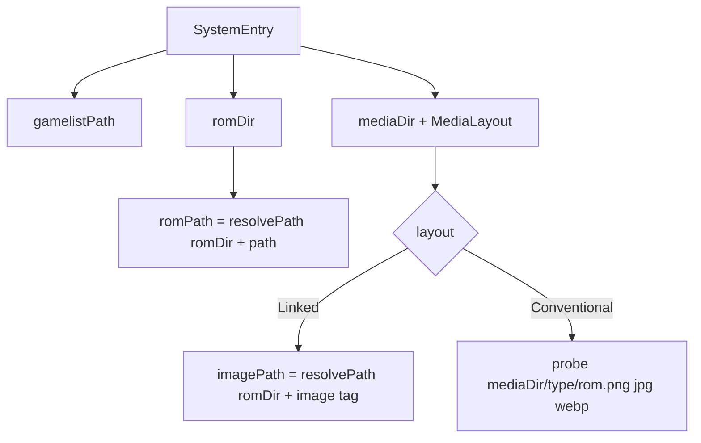

# ES-DE layout support (and later sync)

Plan only. Phases are meant to land one at a time, each reviewable on its own.

## 1. The core difference

| | Legacy ES / Batocera / RetroBat | ES-DE |
|---|---|---|
| Gamelist | `<roms>/<sys>/gamelist.xml` | `<appdata>/gamelists/<sys>/gamelist.xml` (unless `LegacyGamelistFileLocation=true`) |
| ROMs | next to the gamelist | `ROMDirectory/<sys>` from `settings/es_settings.xml` |
| Media | `<image>`/`<video>` link, relative to the gamelist folder | no link; found by convention: `MediaDirectory/<sys>/<type>/<rom rel path minus ext>.<png\|jpg\|webp>` |
| `<path>` | relative to the gamelist folder | `./…` relative to `ROMDirectory/<sys>` |
| System names | `sg-1000`, … | `sg1000`, … |

There are two separate axes:

- **Where the gamelist lives:** next to the ROMs, or in a separate folder.
- **How media is found:** by link or by convention.

`LegacyGamelistFileLocation=true` combines "gamelist next to ROMs" with "media by convention", so
the code must not merge the two axes into one flag.

**What blocks this today:** `Gamelist::load` sets `FSystemDir` to the gamelist's folder and uses
that one folder as both the ROM base and the media base. Everything else depends on that.



### ES-DE reference facts

- App data: `~/ES-DE` (Windows `C:\Users\<u>\ES-DE`, portable `ES-DE\ES-DE`; old releases
  `~/.emulationstation`).
- Settings: `<appdata>/settings/es_settings.xml`, entries like
  `<string name="ROMDirectory" value="..."/>`.
  - `ROMDirectory` defaults to `~/ROMs` (portable `ES-DE\ROMs`); may contain `~` or `%ESPATH%`.
  - `MediaDirectory` empty means `<appdata>/downloaded_media`; `%ESPATH%` allowed.
- Gamelists inside ROM folders are ignored unless `LegacyGamelistFileLocation=true`; new ones are
  always created under `gamelists/`.
- Media types: `3dboxes`, `backcovers`, `covers`, `custom`, `fanart`, `manuals`, `marquees`,
  `miximages`, `physicalmedia`, `screenshots`, `titlescreens`, `videos`.
  - Subfolders of the ROM path are mirrored under the type folder.
  - Directories interpreted as files keep their suffix: `dig.scummvm.png`.
  - Image extensions `jpg png webp`; video `mp4 mkv avi wmv mov webm m4v`; lowercase on Linux.
- Extra ES-DE fields: `sortname`, `collectionsortname`, `completed`, `broken`, `nogamecount`,
  `nomultiscrape`, `hidemetadata`, `controller`, `altemulator`, `playtime`, `screen`, plus
  `<folder>` entries.
- Compatibility with legacy ES is one-way: ES-DE may drop tags it does not know (but see the
  findings below: on the sample install it kept them).
- ES-DE keeps entries whose ROM is missing, and rewrites gamelists on exit like ES does.

### Findings from a real install (Android ES-DE on an SD card)

Card layout: `ES-DE/` (app data) next to `ROMs/<sys>/`. `ROMs/<sys>/` also holds a hand-copied
legacy `gamelist.xml` + `images/` + `videos/` for 19 of the 23 systems. ES-DE ignores those
files; they are the user's manual stand-in for the sync feature.

- **`gamelist.xml` is multi-root** when a system-wide alternative emulator is set (`mame`,
  `scummvm`):

  ```xml
  <?xml version="1.0"?>
  <alternativeEmulator>
  	<label>MAME 2003-Plus</label>
  </alternativeEmulator>
  <gameList>
  	<game>…
  ```

  `Gamelist::load` fails on it today: `setContent` rejects a second root, and
  `documentElement()` would be `<alternativeEmulator>` anyway.
- **`es_settings.xml` is multi-root** (flat `<bool …/>`, `<string …/>` lines, no wrapper).
- **No `ROMDirectory` key** on Android; `MediaDirectory` is empty (so `downloaded_media`). The
  ROMs are at `<appdata>/../ROMs`, which matches the portable default.
- **ES-DE kept the Batocera/Skraper tags** it does not use: `<image>`, `<video>` (500+ each),
  `<provider>`, `gametime`, `genreid`, `family`, `lang`, `region`, `arcadesystemname`,
  `<game id="…">`. ES-DE reformats with tabs and `<?xml version="1.0"?>`.
- **`<folder>` entries** exist (`pcengine`: multi-disc `./Avenger/…cue`). The loader only reads
  `<game>`, so they stay untouched in the DOM.
- **Media in use:** `covers` (23 systems) and `videos` (20); the other types only in 3 systems.
  Extensions: 1126 `png`, 694 `mp4`, 4 `jpg`, 1 `jpeg` (ES-DE ignores `.jpeg`), plus two `.bak`
  files and an Android `.nomedia` marker.

## 2. Phases

### Phase 0: split the folders (refactor, no behaviour change)

- **`SystemEntry` (`Systems.h`):** add `romDir` (empty means the gamelist's folder, so nothing
  changes for current users). **Done.** `mediaDir` and `enum MediaLayout { Linked, Conventional }`
  arrive with Phase 2, where something reads them.
- **`Gamelist::load`:** `FSystemDir` is now `FRomDir`, taken from `SystemEntry::romDir`. **Done.**
- **`systemDir()` callers:** all renamed to `romDir()`; `gamelistBackups` already used
  `system().gamelistPath`. **Done.**
- **Side benefit:** this also covers RetroPie's `~/.emulationstation/gamelists/<sys>`, which is
  the same split with linked media.
- **Tests:** the existing suite passes unchanged; one new test loads a gamelist whose ROMs and
  media live in another folder.

### Phase 1: detect and scan ES-DE (`Systems.cpp`)

- **Detection:** the user opens a root. If it contains `gamelists/` and
  `settings/es_settings.xml`, it is an ES-DE app-data folder.
- **Read `ROMDirectory` and `MediaDirectory`:**
  - Expand `~` and `%ESPATH%`. Empty `MediaDirectory` means `<appdata>/downloaded_media`.
  - `es_settings.xml` is most likely multi-root (a flat list of `<string …/>`). Parse it wrapped
    in a fake root, or read it with `QXmlStreamReader`, which handles multiple roots.
  - `%ESPATH%` is the folder of the ES-DE executable, which we cannot know. Assume the app-data
    parent (portable layout). If the resulting ROM folder does not exist, ask the user and store
    the answer in `QSettings` per app-data path.
  - Android writes no `ROMDirectory` at all: fall back to `<appdata>/../ROMs`, then ask.
- **Scan:** list `gamelists/*/gamelist.xml` →
  `SystemEntry{ sys, kind, gamelist, romDir/<sys>, mediaDir/<sys>, Conventional }`.
- **Return type:** `Result<QVector<SystemEntry>>`. A missing or unreadable `es_settings.xml`
  returns an error message, not an empty list.

### Phase 1b: multi-root `gamelist.xml` (needed by any ES-DE load)

- `load` wraps the file content in a fake root before `setContent`, and works on the
  `<gameList>` child; `save()` writes the children of the fake root back out. Top-level siblings
  such as `<alternativeEmulator>` and their order survive the round trip.
- Applies to every layout: it costs nothing for single-root files.

### Phase 2: conventional media in `Gamelist`

- **Reading (`gameFromNode`):** in `Conventional` mode, ignore `<image>`/`<video>` (ES-DE does
  too), but leave existing tags in the DOM: they are the legacy links the sync reads. Probe
  `mediaDir/<imageType>/<romRelNoExt>.{png,jpg,webp}` and `videos/…{mp4,mkv,avi,wmv,mov,webm,m4v}`
  through `resolvePath`.
  - `ponytail:` note: up to 3+7 stats per game at load time. Upgrade path: one directory listing
    per type folder, which the private `mediaIndex()` in `MediaOps` almost already does.
  - Folder games keep their suffix in the media name: `dig.scummvm.png`.
- **Writing:**
  - `setImage` targets `<imageType>/<romRelNoExt>.png`. `setVideo` keeps the source extension,
    lowercased, because ES-DE on Linux only matches lowercase extensions.
  - Neither writes a DOM tag, and neither needs a `save()`.
  - A stale `.jpg`/`.webp` sibling would compete with the new file, so the same `MediaWrite`
    journal moves it to `.gle-bak`.
  - `freeMediaLink` and the `_N` suffixes do not apply: one ROM means exactly one name.
- **Removing:**
  - `removeImage`/`removeVideo` delete the file directly. `sharedFile` does not apply, because a
    conventional name belongs to one ROM.
  - `removeGame(s)` also deletes that ROM's files across the media type folders (all types, or
    only image and video: open question 3).
- **Disabled in this layout:** `linkMedia`, `renameMedia`, `unlinkedMedia`, `misnamedMedia`, and
  their UI. The ES-DE counterpart, media files with no matching ROM, is a later feature.
- **`addGames`:** must write `./`-prefixed paths relative to `romDir`. Check what it writes today.
- **`unlistedRoms`:** the ES-DE ROM folder can still contain legacy `gamelist.xml`, `images/`,
  `videos/`, `media/`; keep skipping them there.
- **ES-DE-only fields** need nothing: the editor only rewrites tags it knows and leaves the rest
  of the DOM alone.

### Phase 3: UI

- **Opening a root:** the open-root dialog accepts both kinds of root, and the status bar or title
  shows `ES-DE` / `Linked`.
- **One new settings key:** `EsdeImageType`, default open (question 2).
- **Menus:** link/rename entries are disabled in `Conventional` mode.
- **`GameEditPanel`:** no change; it already shows `physicalImagePath`.
- **Help text:** one line that ES-DE must be stopped while editing.
- **Scraping (optional):** `ScrapePanel::finishSave` could save every downloaded type into its
  own folder. YAGNI until someone asks for it. Mapping:

| Scrape type | ES-DE folder |
|---|---|
| `box-2D` | `covers` |
| `ss` | `screenshots` |
| `sstitle` | `titlescreens` |
| `box-3D` | `3dboxes` |
| `wheel` | `marquees` |
| `mixrbv*` | `miximages` |
| `video` | `videos` |

## 3. Groundwork for the later sync (nothing built now)

Phase 0 already gives the sync what it needs: every game has a layout-independent `romPath`,
`imagePath` and `videoPath`. The sync itself would be:

- **First real case (the sample card):** legacy `ROMs/<sys>/gamelist.xml` and ES-DE
  `gamelists/<sys>/gamelist.xml` share one ROM folder, so games match by `<path>` directly, and
  media maps `ROMs/<sys>/images/X.png` → `downloaded_media/<sys>/covers/X.png`,
  `videos/X.mp4` → `videos/X.mp4`.

- **System pairing:** a small mapping table of ES-DE ↔ Batocera names (`sg1000` ↔ `sg-1000`, …),
  keyed on the existing `kind`.
- **Game matching:** by `<path>` relative to each `romDir`, then by file name, then by CRC
  (already in `Hashes`).
- **Core function (widget-free, testable):**
  `diffGamelists( const Gamelist& a, const Gamelist& b ) -> QVector<SyncRow>`. Each row holds the
  index in A and B, the differing fields, and whether the media is missing on one side.
- **Dialog:** in the style of `F_LinkMedia`, with a direction per row (A→B, B→A, skip). Fields are
  applied with `setFields` + `changedFields`; media with `setImage`/`setVideo`, which handle both
  layouts after Phase 2.
- **Limits to state in the UI:**
  - With no stored base version there is no three-way merge; the user decides each conflict.
  - Batocera's extra media tags (`thumbnail`, `marquee`, `fanart`, `manual`) would need `Game` to
    carry more than one image. That is a sync v2.

## 4. Risks and open questions

1. ~~Multi-root `gamelist.xml`~~ **Confirmed** on the sample install; handled by Phase 1b.
2. **Which ES-DE type is "the" image?** The sample install uses `covers` almost exclusively, so
   that is the default; `EsdeImageType` stays as the switch for `miximages` users.
3. **What should `removeGame` delete?** All media types (manuals and fanart too), or only the
   image and video the editor manages.
4. **ES-DE systems with ROMs but no `gamelist.xml` yet:** list them in v1, or skip them like today.
5. **Portable `%ESPATH%` / Android:** "app-data parent, else ask" fits the sample card; still
   unverified on a desktop install with a custom `ROMDirectory`.
6. **`.jpeg` media:** ES-DE ignores it. Show it as missing (what ES-DE shows), or offer to
   re-encode it to `.png`?

## 5. Tests to leave behind

- **`tst_Systems`:** an ES-DE fixture (`gamelists/snes/gamelist.xml`, `settings/es_settings.xml`
  with `%ESPATH%`, a ROMs folder) scans to the right `romDir`/`mediaDir`.
- **`tst_Gamelist`:**
  - Conventional resolution: `covers/Sub/Game.jpg` found for `./Sub/Game.zip`.
  - `setImage` writes `covers/…png`, adds no `<image>` tag and removes the `.jpg` sibling.
  - `removeGame` deletes the conventional files.
  - Multi-root round-trip: `<alternativeEmulator>` + `<gameList>` loads, saves, and keeps both
    roots in order (fixture copied from the sample `mame` file, descriptions trimmed).
- **Phase 0:** no new test; the existing suite is the check.
