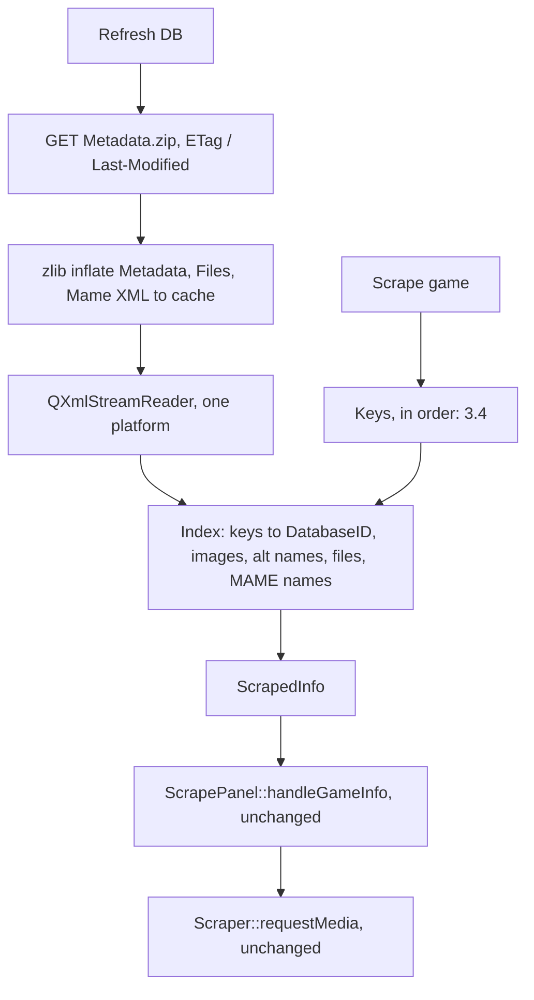

# LaunchBox Games DB scraper

Plan only. Decision: scrape from a local copy of the LaunchBox metadata dump (`Metadata.zip`),
matched by name. ScreenScraper stays as it is.

## 1. Source

LaunchBox has no public lookup API. The LaunchBox app itself downloads one archive,
`https://gamesdb.launchbox-app.com/Metadata.zip`: 104 MB zipped, four XML files, `Metadata.xml`
alone 517 MB with about 1.6M records (190,174 games, 71,557 alternate names, 1,347,363 images).
Last modified 2026-10-29 08:00:42 GMT, 108,959,976 bytes, with an `ETag`. Checked on 2026-10-29
against a real download (counts, field coverage, element order, platform names) and against
RomM's import code. Not checked: the `Genres` separator, bigscraper-qt, RomM's handler files.

`Metadata.xml` also holds `Platform`, `PlatformAlternateName`, `Emulator` and `EmulatorPlatform`
records; we ignore them (`Platforms.xml` has the same platforms).

| File | Element | Fields we use |
|---|---|---|
| `Metadata.xml` | `<Game>` | `DatabaseID`, `Name`, `Platform`, `ReleaseDate` (always `YYYY-MM-DD` or empty, empty on 40%; some `-01-01` values are probably year-only; RomM's fixture has `2000-08-11T00:00:00-07:00`, not seen in the real dump), `ReleaseYear` (only 67k games), `Overview`, `MaxPlayers` (missing on 25%), `Genres` (`;`-separated, empty on 10%; separator not verified), `Developer`, `Publisher`, `CommunityRating` (0.5-5, float, missing on a third) |
| `Metadata.xml` | `<GameAlternateName>` | `DatabaseID`, `AlternateName`, `Region` |
| `Metadata.xml` | `<GameImage>` | `DatabaseID`, `FileName` (no upper-case extension in this dump), `Type`, `Region` (absent on 37%). No platform: link by `DatabaseID` only |
| `Files.xml` | `<File>` | `FileName` (no extension, tags kept: `20th Century Video Almanac (USA)`), `Platform`, `GameName`: known ROM names to titles (85k). `GameName` keeps the tags, so it is not a `Name` in `Metadata.xml`; run it through the name key. Outside Arcade `FileName` equals `GameName`, so it adds nothing there |
| `Mame.xml` | `<MameFile>` | `FileName` (MAME short name), `Name`; also `Year`, `Developer`, `Publisher`, `Genre` (48k). `<MameListItem>`: `FileName`, `GameName` |
| `Platforms.xml` | `<Platform>`, `<PlatformAlternateName>` | `Name` (190), `Alternate` (431); to build and check our platform table |

Images: `https://images.launchbox-app.com/<FileName>`. `VideoURL` is on 82k games: 60k YouTube, 22k
direct Steam CDN files (Windows games). On the retro platforms checked (NES, SNES, Genesis,
Arcade, PSX and others) it is YouTube bar a handful: no video for our systems.

### Rejected: HTML scraping (bigscraper-qt)

[bigscraper-qt](https://github.com/Fr75s/bigscraperqt) (Python, GPL-3.0, last push 2023-05)
scrapes the site's HTML instead: it walks `/platforms/games/<slug>/page/<n>` until a title
matches, then reads `/games/details/<id>` and `/games/images/<id>` with XPath. Rejected because:

- it breaks whenever the site's markup changes;
- one game can cost hundreds of page requests, with no throttle (a block waiting to happen);
- it has no offline use and no consistent snapshot.

What we take from it: the name key (`form()`), the platform list as a checklist, and the
LaunchBox image type names as the common vocabulary (`ss_arts`, `pegasus_artconv`).

### Reference: RomM

[RomM](https://github.com/rommapp/romm) (Python, AGPL-3.0) uses the same dump, which confirms the
choice. Files: `backend/tasks/scheduled/update_launchbox_metadata.py` (import) and
`backend/handler/metadata/launchbox_handler/` (`handler.py`, `remote_source.py`, `media.py`,
`utils.py`).

- Import: scheduled task, streaming `iterparse` with `root.clear()` per record, all platforms
  into Redis hashes in batches of 2000, versioned so a format change drops the whole store.
- Lookup: local LaunchBox install, `(launchbox-<id>)` tag in the file name, `Files.xml` by file
  name, then a search term (tags stripped, `_` to space, MAME short name via `Mame.xml`,
  `" - "` to `": "`) tried as exact name, de-inverted article, alternate name (platform-checked),
  and folded title last.
- Media: per slot a list of types in order of preference, region as tie-break (from the ROM's
  file-name tags, then the user's region order); back, spine and 3D box follow the front's region.

What we take: `Files.xml` and `Mame.xml` lookups, the article variant, type fallbacks and the
region tie-break. Not taken: local LaunchBox install, the id tag, Redis. Ideas only, no code
(AGPL).

## 2. Flow

Everything after `ScrapedInfo` already exists: `handleGameInfo`, `requestMedia`, the save path
through `Gamelist::setImage` (re-encodes to PNG).

## 3. Pieces

### 3.1 Download and unzip

- Download with the existing `QNetworkAccessManager` into `QStandardPaths::CacheLocation`,
  through `QSaveFile`. Re-download only when `ETag` / `Last-Modified` changed.
- Qt has no public zip API (`QZipReader` is private). zlib is already linked: read the central
  directory (the local headers may leave sizes to a data descriptor), then
  `inflateInit2( …, -15 )` and stream `Metadata.xml`, `Files.xml` and `Mame.xml` to disk.
  No zip64 unless the archive ever passes 4 GB.

### 3.2 Index

- `QDomDocument` on the full file is out. One `QXmlStreamReader` pass per file, keeping only the
  requested platform's games, alternate names, images and `<File>` entries. `Mame.xml` only for
  arcade kinds.
- Alternate names and images carry no platform, only `DatabaseID`. Pass 1 collects the platform's
  game IDs; pass 2 keeps the images and alternate names whose ID is in that set (hashing all
  1.35M images instead is too heavy). In this dump all `<Game>` come first, then
  `<GameAlternateName>`, then `<GameImage>`, with each game's images contiguous. That is not a
  contract, so don't rely on it; one pass would work today.
- The pass over 517 MB is not measured; expect tens of seconds, not seconds. Do it once per
  platform, show progress, and cache the result.
  `Scraper` is "async on the main thread, no locks", so this is the first job that needs either
  chunking via the event loop or a worker thread handing back a value.

### 3.3 Platform names

New table `Cst_SystemKindLbName[skCount]` in `Resources`, with the platform names exactly as
`Metadata.xml` writes them ("Nintendo Entertainment System", "Sega Genesis", ...). Empty for kinds
without an equivalent; scraping from LaunchBox is then disabled for that system. Mega Drive and
Genesis share one entry (`Metadata.xml` has only "Sega Genesis"). Build the table from
`Platforms.xml` (names such as "NEC TurboGrafx-16" for PC Engine are not guessable) and use its
`PlatformAlternateName` entries to cross-check.

### 3.4 Name key and lookup order

Port of bigscraper-qt's `form()`, one free function:

1. drop everything inside `()`, `[]`, `{}`;
2. remove accents (decompose, drop combining marks);
3. uppercase, trim;
4. `&` to `AND`; drop `. ! ? '`; spaces, `:`, `-` to `_`; collapse repeated `_`.

Because `:` and `-` both become `_`, RomM's `" - "` to `": "` step is not needed.

Order tried, first hit wins:

1. `Files.xml`, Arcade only (elsewhere it equals step 3): ROM file name without extension, tags
   kept, case-insensitive, for the platform; gives a `GameName`, which goes through the name key
   (it carries tags like "(World, set 1)"). Measured: adds 7,158 matches on Arcade.
2. Arcade kinds: `Mame.xml` maps the short name (`sf2`) to a title, which goes through the steps
   below (19,704 of its 48,781 titles match an Arcade game by name key). Its `Year`, `Developer`,
   `Publisher` and `Genre` could fill gaps later.
3. `form()` of the ROM file name without extension.
4. `form()` of `Game::name`.
5. Either one with a trailing article moved to the front ("Legend of Zelda, The").
6. Alternate names (the index is per platform already).

Exact match only. Several hits: take the first and say so (name-key collisions within a
platform: about 1% on NES, 1.5% on Arcade). None: "Game not found".
Before writing it, check what `NameEdit` already has.

### 3.5 Field mapping into `ScrapedInfo`

| `ScrapedInfo` | From |
|---|---|
| `name` | `Name`, or the `AlternateName` for the user's region |
| `region` | `Region` of the matched alternate name, else empty |
| `description` | `Overview` |
| `releaseDate` | first 10 chars of `ReleaseDate` through `formatScrapedDate` (it accepts 4, 7 or 10 chars; any offset is dropped); else `ReleaseYear`. A `-01-01` date may be year-only and is taken as is. `formatScrapedDate` is file-local in `Scraper.cpp`: expose it or move it |
| `genre` | `Genres`, split on `;`, each trimmed, joined with `" - "` |
| `developer` / `publisher` | same-named elements |
| `players` | `MaxPlayers` |
| `rating` | `CommunityRating / 5` (0-1, what ES reads). Needs the ScreenScraper fix first, see phase 0 |
| `pictures` | `GameImage` picked per 3.6 |
| `videoLink` | always empty |
| `maxThreads` | fixed 2 |

Language: English only; `FLanguage` is ignored.

### 3.6 Media types

Per checkbox, the first type in the list that has an image wins:

| Checkbox | LaunchBox `Type`, in order |
|---|---|
| Box 2D | Box - Front, Box - Front - Reconstructed, Fanart - Box - Front |
| Box 3D | Box - 3D |
| Screenshot | Screenshot - Gameplay |
| Title | Screenshot - Game Title |
| Wheel | Clear Logo |
| Arcade box, Mix 1, Mix 2 | none: disabled for LaunchBox (candidates if wanted: `Arcade - Marquee`, `Arcade - Cabinet`, `Banner`, `Fanart - Background`) |

Within that type, prefer the game's region: `Game::region` if set, else the ROM's tags
(`(USA)`, `(Europe)`, `(Japan)`), mapped to LaunchBox regions (USA: North America, then United
States; Europe; Japan; World; also Germany, France, Spain, United Kingdom, Australia and others
that the tags name). No match: the first image of the type. Box 3D follows the region Box 2D picked.

### 3.7 UI

- `ScrapePanel`: source choice, "Refresh LaunchBox DB" with progress, `Chk_Video` and the
  CRC fields disabled for LaunchBox.
- Settings: `ScrapeSource`. No credentials, nothing secret.

## 4. Tests

`tests/tst_LaunchBoxDb.cpp`, with our own records in the shape of RomM's fixture
(`backend/tasks/fixtures/launchbox/metadata.xml`):

- a few `<Game>` / `<GameAlternateName>` / `<GameImage>` / `<File>` / `<MameFile>` records:
  index one platform, ignore the others;
- name key: brackets, accents, `&`, punctuation, separators, trailing article;
- lookup by `Files.xml`, by MAME short name, by file name, by `Game::name`, by alternate name;
  not found;
- date plain and with offset, empty date with `ReleaseYear`, genre with spaces, rating mapping;
- `Files.xml` name without extension, with tags;
- image pick: type fallback, region tie-break, no region, upper-case extension;
- one tiny zip fixture for the inflate path, with a data descriptor.

## 5. Phases

0. Rating fix (done): the ScreenScraper path copied `<note>` (0-20) unconverted into `<rating>`,
   which ES reads as 0-1. `parseScrapeResponse` now divides by 20.
1. Name key + index + lookup + mapping from a plain XML stream (`QIODevice`), with tests; time it
   once on the real `Metadata.xml`. No download, no unzip, no UI.
   Done: `scraper/LaunchBoxDb`, `tests/tst_launchboxdb.cpp`. `formatScrapedDate`
   is now public in `Scraper.h`. `find()` returns `LaunchBoxMatch` (the `ScrapedInfo` plus an
   `ambiguous` flag for the "several hits, took the first" message).
   Timed on the real dump (2026-10-29, MinGW -O3, one pass of each file): `Metadata.xml` takes
   16-18 s per platform (NES 3,861 games, Arcade 7,206, Genesis 2,171), `Files.xml` about 0.5 s,
   `Mame.xml` about 1.5 s. So the index needs the worker thread and progress in phase 3.
   Also checked: `Genres` is `;`-separated (`Role-Playing; Shooter`), `MaxPlayers` is a plain
   integer (1 on 97k games, nothing odd in the top values), lookups on NES ROM names found
   name, date, genre, rating and five pictures.
2. Download and unzip (3.1), platform table (3.3).
   Status 2026-10-29: **done and verified** (build clean, no new warnings; 179 tests pass, 11
   skipped; real archive checked, see below).
   Written:
   - `src/scraper/LaunchBoxDump.h/.cpp` (in `gle_scraper` in `CMakeLists.txt`): `unzipEntries(
     zip, names, destDir )` (own central-directory reader + zlib `inflateInit2( -15 )`, stored and
     deflated, CRC and size checked, all-or-nothing through `QSaveFile`, no zip64) and class
     `LaunchBoxDump` (`refresh()`, signals `downloadProgress`, `unpacking`, `finished( updated )`,
     `failed( msg )`; `isCached`, `filePath`, `defaultCacheDir` = `CacheLocation/launchbox`,
     `setProxy`, `setUrl` for tests). It sends `If-None-Match` / `If-Modified-Since` only while all
     three XML files exist, writes the zip with `QSaveFile`, inflates `Metadata.xml`, `Files.xml`,
     `Mame.xml` on a `QThread::create` worker, deletes the zip, and stores the validators only after
     a successful unpack (a failed unpack makes the next refresh download again). `Platforms.xml`
     is not extracted.
   - `Resources.h/.cpp`: `Cst_SystemKindLbName[skCount]` (checked by hand against the real
     `Platforms.xml`, 190 platforms; Neo Geo = "SNK Neo Geo AES" (181 games vs 38 for MVS), MAME,
     FBA and Arcade kinds = "Arcade", MSU1 = SNES, empty for CaveStory, Lutro, PRBoom, Daphne,
     Ports, SNES CD, Other), and the settings keys `Cst_IniLaunchBoxETag`, `Cst_IniLaunchBoxModified`
     (group `Options`).
   - Tests: `tests/tst_launchboxdump.cpp` (hand-built zips with data descriptor and local extra
     field, 700 kB compressible and 200 kB incompressible entries, bad CRC writes nothing, missing
     entry, not a zip; a `QTcpServer` fake: 200 then 304 with the ETag, then a missing file forces
     a full download; a non-zip body fails and stores no ETag) and a table test in
     `tests/tst_resources.cpp`. Both are listed in `CMakeLists.txt`.
   Verified:
   1. Build: no errors, no warnings in `LaunchBoxDump.cpp` after the `memcpy` EOCD edit.
   2. `build/tests.exe`: 190 tests, 179 passed, 11 skipped (the 9 usual ones plus the dev-credentials
      and symlink skips).
   3. Real `Metadata.zip` (109 MB, 577 MB unpacked): `unzipEntries` inflates `Metadata.xml`,
      `Files.xml`, `Mame.xml` in 1.9 s, CRC passes, sizes equal the extracted copies. Throwaway
      test deleted.
   4. Not done on purpose: unpack progress (only the download reports it), zip64.
   Notes for phase 3: the UI must close or drop the `LaunchBoxDb` readers before `refresh()`
   (Windows will not replace an open file); the cache folder holds 577 MB unpacked; the proxy
   settings have to be passed to `LaunchBoxDump::setProxy` as `ScrapePanel::activate` does for
   `Scraper`.
3. Panel: source choice, refresh, disabled controls.
   Done 2026-10-29 as a full alternative (source choice), in `ui/ScrapePanel`:
   - `Cbo_Source` (ScreenScraper / LaunchBox), stored as `Options/ScrapeSource` (`Cst_IniScrapeSource`,
     0 or 1) on change and read in `activate()`. Switching clears the old results.
   - LaunchBox disables Mix 1, Mix 2, Arcade Box, Video and the manual CRC; no hashing happens.
     `Btn_RefreshLaunchBox` (visible only for LaunchBox) drives `LaunchBoxDump`; the download
     reports through `Img_Loading` (determinate), the unpack makes it indeterminate again.
     `Lbl_Note` shows "updated" / "already up to date" and the ambiguous-name notice.
   - Scrape: no platform in `Cst_SystemKindLbName` or no cache gives a warning box. Otherwise the
     index of that platform is built on a `QThread` (panel busy), kept as one `shared_ptr<LaunchBoxDb>`
     (one platform at a time, dropped when a refresh downloaded something) and `find()` feeds the
     unchanged `handleGameInfo`. The proxy settings go to `FDump` in `activate()` too.
   - `ScrapePanel( parent, launchBoxDir )` takes the cache dir so tests use a temp one. Tests in
     `tests/tst_scrapepanel.cpp`: source toggles controls and is remembered, scrape indexes on the
     worker and reuses the index (Metadata.xml replaced by junk, second scrape still works), no
     dump warns, game not found warns.
   - Not done: a real-network refresh through the panel (the dump itself is tested against a fake
     server), progress while the index is built (indeterminate bar only), "fallback when
     ScreenScraper misses".
4. README: feature checklist, "Third-party components" line for LaunchBox data.

## 6. Open

- **License of the dump.** Settled: personal use is fine, so we build it. Revisit before any
  public release that ships the feature (the site states no terms, RomM using it settles nothing).
  Phases 2 and 3 can go ahead.
- **Fallback or alternative?** Decided: alternative (source choice). A fallback on top is still
  possible later.

- **Name-only matching** is weak on messy ROM names. `Files.xml` and `Mame.xml` cover the worst
  cases; fuzzy matching is a later step, marked `ponytail:` when it lands.
