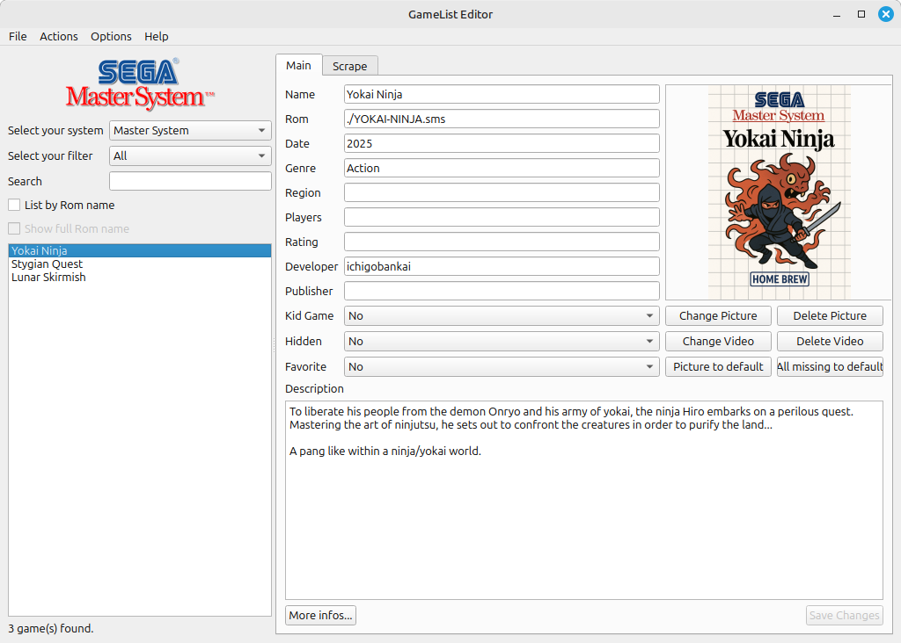

# GameList_Editor_Qt

[](https://github.com/MikeBergmann/GameList_Editor_Qt/actions/workflows/ci.yml)
[](https://github.com/MikeBergmann/GameList_Editor_Qt/actions/workflows/ci-windows.yml)
[](https://github.com/MikeBergmann/GameList_Editor_Qt/actions/workflows/ci-macos.yml)

**Qt6 Port of GameList Editor Delphi**

<a href="./screenshot.png">
  
</a>

(Cover of Yokai Ninja is AI generated)

## The Why

There are a lot of great ROMs for vintage computers/consoles or for their emulators on itch.io.

To manage these ROMs, I used [GameList Editor](https://github.com/andresdelcampo/GameList_Editor) as my 'the' tool for editing/scraping my gamelist.xml.

I want to add some features, but unfortunately, it is written in Delphi (which I don't have a dev toolchain for).

So this repo contains my C++/Qt6 port of the GPLv3 `andresdelcampo/GameList_Editor` (itself a fork of `NeeeeB/GameList_Editor`).

## First Step

- Target: Linux Mint 22.1 (Ubuntu 24.04), Qt6.4, cmake, gcc; also builds on Windows with Qt's MinGW kit (tested with Qt 6.12 / MinGW 13.1)
- Build dependencies (Ubuntu/Mint): `qt6-base-dev qt6-multimedia-dev zlib1g-dev libgtest-dev`
- Windows: install Qt 6 (MinGW kit, with Qt Multimedia, CMake and Ninja) via the Qt installer. zlib comes with the MinGW kit; GoogleTest is downloaded by CMake if not installed.

  ```
  set PATH=C:\Qt\Tools\CMake_64\bin;C:\Qt\Tools\Ninja;C:\Qt\Tools\mingw1310_64\bin;C:\Qt\6.12.0\mingw_64\bin;%PATH%
  cmake -S . -B build -G Ninja -DCMAKE_BUILD_TYPE=Release -DCMAKE_PREFIX_PATH=D:/Qt/6.12.0/mingw_64
  cmake --build build
  build\tests.exe
  windeployqt dist\GameListEditor.exe   # only needed to run it without Qt on PATH (copy the exe to dist\ first, not next to tests.exe)
  ```

- Testing: Google Test
- First drop will contain:
  - No SSH / no Pi remote control
  - English-only UI
  - No theming (default Qt widget style only)

## Current Status

### Implemented

- [x] Loading and systems
- [x] Browsing, searching and filtering the game list
- [x] Edit a game
- [x] Scrape using screenscraper.fr
- [x] Manually adding new games
- [x] Linking existing media, and renaming linked media after their ROM (both with a review before anything changes)
- [x] Shrinking large pictures: re-encodes linked pictures over a chosen size.
- [x] Video playback
- [x] Windows build
- [x] Actions → System: delete orphans, delete duplicates (first entry of a ROM stays), export the list to a txt file (what the list currently shows)
- [x] Actions → Selection: add to or remove from Favorites and Hidden, and the Advanced name editor (trim, case, prefix/suffix on every selected game)
- [x] ES-DE folders (see below)
- [x] Sync to another folder, ES-DE or legacy in either direction (see below)

### ES-DE

Choose the ES-DE folder (the one holding `gamelists` and `settings`) instead of a ROM folder:

```
ES-DE/
├── settings/es_settings.xml
├── gamelists/nes/gamelist.xml
└── downloaded_media/nes/{covers,videos,screenshots,...}
ROMs/nes/
```

The title bar then reads "GameList Editor Qt - ES-DE". Choosing a ROM folder gives the usual view.

The ROM folder used is `ROMDirectory` from `es_settings.xml`, else the `ROMs` folder beside the ES-DE folder. 

Current limitation: A scraped picture is saved as the cover, whichever type you picked.

### Sync

Actions → Sync to other folder... copies the open folder (the master) into another folder, one way. Either side can be ES-DE or a legacy layout. Systems pair by folder name, else by type (`megadrive` and `genesis` are two types and are not paired). A review lists each system's counts, the games only the target has, and the problems, before anything is written.

- **Copied:** the ROMs (when the target's ROM folder is another folder; sizes are compared), `name`, `genre`, `rating`, `players`, `developer`, `publisher`, `releasedate`, `desc`, `region`, and the cover and video (compared by size, then MD5).
- **Stays per device:** favorite, hidden, kid game, play count, last played, and every child the editor does not know.
- **Never removed:** games only the target has are listed and kept.
- **Media** is copied byte for byte. ES-DE reads only `jpg`, `png` and `webp` covers, so other pictures become PNG on the way in; a video ES-DE cannot play is skipped and listed. Converted covers are copied only when missing.
- A failing system is reported and the others still run; cancel stops between files. A second run finishes what was left.

Pitfalls:

- Stop EmulationStation on the target first: it rewrites its gamelists on exit.
- Games match by ROM path. RetroPie-style absolute `<path>` values do not match and are listed.
- Android over MTP is not a file path on Windows: use a card reader, a share or a local copy. ES-DE on Android often keeps app data in internal storage and ROMs on the SD card; both must be reachable from the PC.
- Screenshots, marquees and the other ES-DE media types are not synced yet.

### Features to add

- [ ] Additional Scrapers (e.g., Launchbox)
- [ ] Scrape every picture type into its own ES-DE media folder
- [ ] Auto-Fix invalid media links
- [ ] Normalize media further, e.g. format
- [ ] Remove unused media
- [ ] Android version

## screenscraper.fr credentials

Scraping needs two separate sets of credentials:

- **Developer credentials** (`devid` / `devpassword`) identify *this application* to the API and grant its request allowance. They are **not** in the repository, and every build that wants to scrape needs its own. Register at [screenscraper.fr](https://www.screenscraper.fr) and ask for developer access, then pass them at configure time:
  
  ```
  cmake -B build -DGLE_SS_DEVID=yourid -DGLE_SS_DEVPWD=yourpassword
  ```
  or export `GLE_SS_DEVID` / `GLE_SS_DEVPWD` before running cmake. Without them the app builds and runs, but scraping reports "no developer credentials". They are baked into the binary, so don't distribute a build made with your own credentials unless you intend to share them.
- **User credentials** (`SSUser` / `SSPwd`) are your personal screenscraper.fr account, entered in the app and stored in your ini.

## Still undecided

Unfortunately, my Mac no longer runs MacOS, so there won't be a MacOS app bundle to download until someone volunteers to test. Nevertheless, I added a CI runner to make sure it builds on MacOS. 

## Third-party components

GameList Editor Qt is licensed under the GPLv3 (see [LICENSE](LICENSE)). The Windows installer additionally ships:

- [Qt 6](https://www.qt.io/) (Core, Gui, Widgets, Network, Xml, Multimedia, MultimediaWidgets), LGPLv3. Source: <https://download.qt.io/official_releases/qt/>. Qt is shipped as separate DLLs, so you can replace them with your own build.
- [FFmpeg](https://ffmpeg.org/) as bundled with Qt Multimedia, LGPLv2.1+.
- The MinGW-w64 / GCC runtime (GPL with the GCC Runtime Library Exception, winpthreads under an MIT-style license).
- [zlib](https://zlib.net/), zlib license.

The license texts are installed next to the program in `licenses\`. The installer itself is built with [Inno Setup](https://jrsoftware.org/isinfo.php).

Console and brand logos are trademarks of their respective owners and are used for identification only. Game metadata comes from [screenscraper.fr](https://www.screenscraper.fr), whose terms apply.

## AI usage

Yes, I used and will use AI. In my opinion, AI is a great tool for every developer to speed up their work and keep learning, especially if you have no colleagues, as in side projects like this.

Most of the code, the code comments, and all unit tests and test data in this repo were generated by AI. What I do: the design and architecture, the decisions, steering the AI step by step, and reviewing, editing, and testing the result.

In detail, I used AI for:

- Writing new code, based on my design and instructions.
- Generating all the unit tests and test data. Doing that manually is just tedious and nothing I do for fun in a side project.
- Converting resource tables from Delphi to C++/Qt6.
- Helping me analyze the Delphi codebase, because the last time I programmed with Delphi was in 1996.
- Doing code review and refactoring, in the absence of a human reviewer.
- Translating the original French comments to English.
- Checking the grammar and spelling of my texts, because I'm not a native English speaker.

This list is not final, and I will probably find more ways to use AI as I go along. Nevertheless, I will not use AI without steering and reviewing the result. I do this for fun and want to learn and understand.

If you find something that looks wrong or unnecessary, please open an issue. Reviews are welcome.
