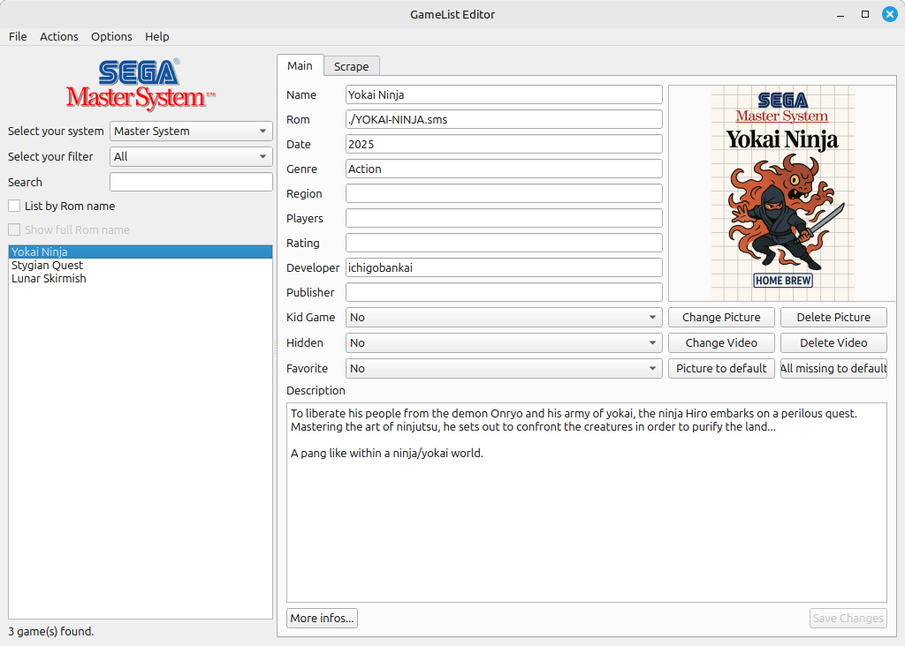
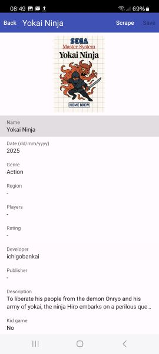
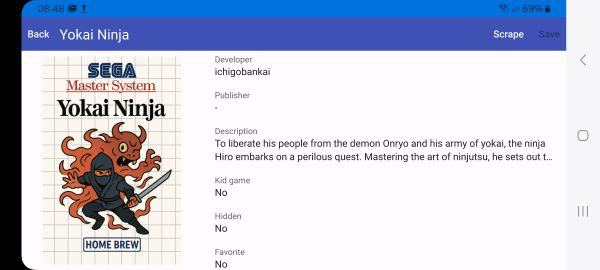

# GameList_Editor_Qt

[](https://github.com/MikeBergmann/GameList_Editor_Qt/actions/workflows/ci.yml)
[](https://github.com/MikeBergmann/GameList_Editor_Qt/actions/workflows/ci-windows.yml)
[](https://github.com/MikeBergmann/GameList_Editor_Qt/actions/workflows/ci-macos.yml)
[](https://github.com/MikeBergmann/GameList_Editor_Qt/actions/workflows/ci-android.yml)

**Qt6 Port of GameList Editor Delphi**

<a href="./screenshot.png">
  
</a>

<p>
  
  
</p>

(Cover of Yokai Ninja is AI-generated)

## The Why

There are a lot of great ROMs for vintage computers/consoles and their emulators on itch.io.

To manage these ROMs, I used [GameList Editor](https://github.com/andresdelcampo/GameList_Editor) as my 'the' tool for editing/scraping my gamelist.xml.

I want to add some features, but unfortunately, it is written in Delphi (which I don't have a dev toolchain for).

So this repo contains my C++/Qt6 port of the GPLv3 `andresdelcampo/GameList_Editor` (itself a fork of `NeeeeB/GameList_Editor`).

## First Step

- Target: Linux Mint 22.1 (Ubuntu 24.04), Windows 11, Android 13+, MacOS 15 (untested). See [Building](#building).
- Testing: Google Test
- Out of scope:
  - SSH / Pi remote control
  - Translations: the UI is English-only
  - Theming: default Qt widget style only (the Android app uses Qt Quick's Material style)

## Building


> [!NOTE]
> These build instructions are AI-generated from the source code, the CI workflows, and my private build helper scripts. They have not been tried on fresh systems. If something is wrong or missing, please drop me a line (open an issue).

### Requirements for all platforms

- Qt 6.4 or newer: Core, Gui, Widgets, Xml, Network, Multimedia, MultimediaWidgets
- CMake 3.21 or newer, Ninja, a C++17 compiler
- zlib
- GoogleTest (optional): CMake downloads v1.14.0 if it is not installed, which needs network access at configure time
- Clone with git, including tags. The app's version information comes from `git describe` and will be `unknown` without it.
- Scraping needs your own screenscraper.fr developer credentials; see [screenscraper.fr credentials](#screenscraperfr-credentials). Without them, screenscraper scraping is disabled.

### Linux (Ubuntu 24.04 / Mint 22, Qt 6.4)

```
sudo apt install build-essential cmake ninja-build git \
     qt6-base-dev qt6-multimedia-dev zlib1g-dev libgtest-dev

cmake -S . -B build -G Ninja -DCMAKE_BUILD_TYPE=Release
cmake --build build
ctest --test-dir build --output-on-failure
./build/GameListEditor
```

On other distributions, install the equivalent Qt 6 base and multimedia development packages, zlib, and GCC or Clang. The tests run headless (`QT_QPA_PLATFORM=offscreen`).

### Windows (Qt's MinGW kit)

The MinGW kit is the tested setup; MSVC is not covered.

1. Install [Git for Windows](https://git-scm.com/download/win).
2. Install Qt with the [Qt Online Installer](https://www.qt.io/download-qt-installer). Select, for your Qt version (6.8 or newer is what CI uses): **MinGW 64-bit**, **Qt Multimedia**, and under Developer and Designer Tools, MinGW (the matching compiler) and **Ninja**.
3. zlib comes with the MinGW toolchain, and GoogleTest is downloaded by CMake.

In a Command Prompt in the repository (adjust the Qt location and versions to your install):

```
set PATH=C:\Qt\Tools\CMake_64\bin;C:\Qt\Tools\Ninja;C:\Qt\Tools\mingw1310_64\bin;C:\Qt\6.8.3\mingw_64\bin;%PATH%
cmake -S . -B build -G Ninja -DCMAKE_BUILD_TYPE=Release -DCMAKE_PREFIX_PATH=C:/Qt/6.8.3/mingw_64
cmake --build build
build\tests.exe
```

- The MinGW and Qt `bin` directories must be on `PATH`, or the exe cannot find its DLLs.
- To run the exe without Qt on `PATH`, copy `GameListEditor.exe` to a separate folder (e.g. `dist\`, not next to `tests.exe`) and run `windeployqt dist\GameListEditor.exe`.
- Do not mix in another GCC (MSYS2, Chocolatey): its ABI does not match Qt's MinGW kit.

### macOS

CI builds and tests it, but nobody has run the app there. Unfortunately, my Mac no longer runs macOS, so there won't be an app bundle to download until someone volunteers to test.

```
xcode-select --install
brew install cmake ninja qt

cmake -S . -B build -G Ninja -DCMAKE_BUILD_TYPE=Release
cmake --build build
ctest --test-dir build --output-on-failure
```

If CMake does not find Qt, add `-DCMAKE_PREFIX_PATH=$(brew --prefix qt)`, or `-DCMAKE_PREFIX_PATH=/path/to/Qt/6.8.3/macos` for a Qt from the Qt installer (include the Qt Multimedia module). zlib comes from the macOS SDK.

### Android (APK)

Prerequisites:

- Qt 6.8 or newer with the **Android arm64-v8a** kit and Qt Multimedia, plus the matching **desktop Qt** kit (needed for `moc`, `rcc` and `qmlcachegen`)
- JDK 17
- Android SDK with the command-line tools, and the NDK your Qt version is built against (Qt 6.8: NDK 26.1.10909125)
- [KDAB `android_openssl`](https://github.com/KDAB/android_openssl) cloned into the SDK root (scraping needs it):
  `git clone --depth 1 https://github.com/KDAB/android_openssl.git <SDK_ROOT>/android_openssl`
- Network access: the last build step runs Gradle, which downloads its dependencies

```
cmake -S . -B build-android -G Ninja -DCMAKE_BUILD_TYPE=Debug \
  -DCMAKE_TOOLCHAIN_FILE=<Qt>/6.8.3/android_arm64_v8a/lib/cmake/Qt6/qt.toolchain.cmake \
  -DQT_HOST_PATH=<Qt>/6.8.3/gcc_64 \
  -DANDROID_SDK_ROOT=<SDK_ROOT> \
  -DANDROID_NDK_ROOT=<SDK_ROOT>/ndk/26.1.10909125
cmake --build build-android
```

- On Windows set `JAVA_HOME` and `ANDROID_SDK_ROOT`, and use the `mingw_64` kit as `QT_HOST_PATH`.
- The debug APK is `build-android/android-build/GameListEditor.apk`. It is debug-signed and installable.
- There are no desktop tests in this build.
- A release APK needs your own keystore, passed through `QT_ANDROID_KEYSTORE_*` environment variables.

## Current Status

### Implemented

- [x] Loading and systems
- [x] Browsing, searching, and filtering the game list
- [x] Edit a game
- [x] Scrape using screenscraper.fr and LaunchBoxDB
- [x] Manually adding new games
- [x] Linking existing media and renaming linked media after their ROM (both with a review before anything changes)
- [x] Shrinking large pictures: re-encodes linked pictures over a chosen size.
- [x] Video playback
- [x] Windows build
- [x] Actions → System: delete orphans, delete duplicates (first entry of a ROM stays), export the list to a txt file (what the list currently shows)
- [x] Actions → Selection: add to or remove from Favorites and Hidden, and the Advanced name editor (trim, case, prefix/suffix on every selected game)
- [x] ES-DE folders (see below)
- [x] Sync to another folder, ES-DE or legacy in either direction (see below)
- [x] Android version, early (see below)

### LaunchBox

Scraping from LaunchBox works offline against a LaunchBox metadata dump. Pick LaunchBox as the source and press **Refresh LaunchBox DB** once to download it into the app's cache (several hundred MB unpacked); pressing it again only downloads when the dump has changed. The first scrape for each platform builds an index, which takes a while. Unlike screenscraper.fr it gives no video and has no CRC lookup.

### ES-DE

Choose the ES-DE folder (the one holding `gamelists` and `settings`) instead of a ROM folder:

```
ES-DE/
├── settings/es_settings.xml
├── gamelists/nes/gamelist.xml
└── downloaded_media/nes/{covers,videos,screenshots,...}
ROMs/nes/
```

The title bar then reads "GameList Editor Qt - ES-DE". Choosing a ROM folder gives the usual view.

The ROM folder used is `ROMDirectory` from `es_settings.xml`, else the `ROMs` folder beside the ES-DE folder. 

Current limitation: A scraped picture is saved as the cover, no matter which type you pick.

### Sync

Actions → Sync to other folder... copies the open folder (the master) into another folder, one way. Either side can be ES-DE or a legacy layout. Systems pair by folder name, else by type (`megadrive` and `genesis` are two types and are not paired). A progress bar shows the analysis (cancel any time). A review lists each system's counts, the problems, and how many games only the target has; a Details button per system lists every game with what would change, before anything is written.

- **Copied:** the ROMs (when the target's ROM folder is another folder; sizes are compared), `name`, `genre`, `rating`, `players`, `developer`, `publisher`, `releasedate`, `desc`, `region`, and the cover and video (compared by size, then MD5).
- **Stays per device:** favorite, hidden, kid game, play count, last played, and every child the editor does not know.
- **Never removed:** games only the target has are listed and kept.
- **Media** is copied byte for byte. ES-DE reads only `jpg`, `png` and `webp` covers, so other pictures become PNG on the way in; a video ES-DE cannot play is skipped and listed. Converted covers are copied only when missing.

Pitfalls:

- Stop EmulationStation on the target first: it rewrites its gamelists on exit.
- Games match by ROM path. RetroPie-style absolute `<path>` values do not match and are listed.
- Folder ROMs (ScummVM and the like) are not synced: they are listed, and their ROM folder is not copied. Fields and media of a folder ROM that the target already lists are still updated.
- Android over MTP is not a file path on Windows: use a card reader, a share, or a local copy. ES-DE on Android often keeps app data in internal storage and ROMs on the SD card; both must be reachable from the PC.
- Screenshots, marquees, and other ES-DE media types aren't synced yet.

### Android

A touch and gamepad front end for phones and handhelds. It has been tried on a Retroid Pocket 5 (Android 13) and a Samsung Galaxy A72 (Android 14). It is an early version. CI builds a debug APK and keeps it as a workflow artifact (`GameListEditor-apk`, no scraping credentials). Release APKs are signed and published by hand, or build it yourself.

- **Same core:** it uses the same `gle_core` and `gle_scraper` as the desktop app, with a new Qt Quick (QML) front end on top. The Widgets UI is not built on Android.
- **Works today:** browse systems and games, search and filter, edit and save a game, change or remove its picture and video, play the video, previous/next game, scrape from screenscraper.fr or LaunchBox, and the review-based Actions: add missing ROMs, link and rename media, shrink large pictures, delete orphans and duplicates, clean up gamelist backups, and export the games list.
- **Help and About:** Help is on the systems page, About at the end of Settings.
- **Not yet:** Sync to another folder, case conversion, region removal and the advanced name editor.
- **Gamepad:** the D-pad moves the focus, A activates, B goes back, L1/R1 switch to the previous/next game. Touch works as well.
- **LaunchBox:** works as described in [LaunchBox](#launchbox). Building a platform's index takes about 45 seconds on the Retroid Pocket 5 and **1 to 2 minutes on the Galaxy A72**. The index is kept until you scrape another platform or the dump changes. Android may clear the cache when it is short of space, which means downloading and indexing again. I did not measure Memory on weak phones.
- **Export:** the games list is written to `<system folder>/<system>.txt`.
- **Pictures:** a scraped picture larger than 2048 px on its longest side is scaled down before it is shown or saved, to spare a phone's memory.
- **Storage:** plain file paths with the "All files access" permission, so it is sideloaded, not on Google Play. The app asks for the permission on first start. It needs Android 13 or newer.
- **Build:** see [Android (APK)](#android-apk) above. The developer credentials work as for the desktop build.
- **Install:** download the APK, allow "Install unknown apps" for the browser or file manager you opened it with, and install. On first start grant "All files access". Updates install over the old version as long as both are release builds; switching between a debug and a release build needs an uninstall first.
- Stop EmulationStation (or ES-DE) first, it rewrites its gamelists on exit.

Known limitations:

- Some long actions (rename and link media, delete orphans and duplicates, the ROM scans) run on the UI thread. On a big library Android may report the app as not responding.
- Unsaved edits are lost if Android kills the app while it is in the background.
- A scrape cannot be cancelled once started.

### Features to add

- [ ] Scrape every picture type into its own ES-DE media folder
- [ ] Auto-Fix invalid media links
- [ ] Normalize media further, e.g. format
- [ ] Remove unused media
- [ ] Sync folder ROMs (ScummVM, etc.); adding them under Add missing ROMs works
- [ ] Android: Sync, case conversion, region removal and the advanced name editor

## screenscraper.fr credentials

Scraping needs two separate sets of credentials:

- **Developer credentials** (`devid` / `devpassword`) identify *this application* to the API and grant its request allowance. They are **not** in the repository, and every build that wants to scrape needs its own. Register at [screenscraper.fr](https://www.screenscraper.fr) and ask for developer access, then pass them at configure time:
  
  ```
  cmake -B build -DGLE_SS_DEVID=yourid -DGLE_SS_DEVPWD=yourpassword
  ```
  or export `GLE_SS_DEVID` / `GLE_SS_DEVPWD` before running cmake. Without them the app builds and runs, but scraping reports "no developer credentials". They are baked into the binary, so don't distribute a build made with your own credentials unless you intend to share them.
- **User credentials** (`SSUser` / `SSPwd`) are your personal screenscraper.fr account, entered in the app and stored in your ini.

## Third-party components

GameList Editor Qt is licensed under the GPLv3 (see [LICENSE](LICENSE)). The Windows installer additionally ships:

- [Qt 6](https://www.qt.io/) (Core, Gui, Widgets, Network, Xml, Multimedia, MultimediaWidgets), LGPLv3. Source: <https://download.qt.io/official_releases/qt/>. Qt is shipped as separate DLLs, so you can replace them with your own build.
- [FFmpeg](https://ffmpeg.org/) as bundled with Qt Multimedia, LGPLv2.1+.
- The MinGW-w64 / GCC runtime (GPL with the GCC Runtime Library Exception, winpthreads under an MIT-style license).
- [zlib](https://zlib.net/), zlib license.

The license texts are installed next to the program in `licenses\`. The installer itself is built with [Inno Setup](https://jrsoftware.org/isinfo.php).

Console and brand logos are trademarks of their respective owners and are used for identification only. Game metadata comes from [screenscraper.fr](https://www.screenscraper.fr), whose terms apply.

## AI usage

Yes, I used and will use AI. In my opinion, AI is a great tool for every developer to speed up their work and keep learning, especially if you have no colleagues, as in side projects like this.

Most of the code, the code comments, and all unit tests and test data in this repo were generated by AI. What I do: the design and architecture, the decisions, steering the AI step by step, and reviewing, editing, and testing the result.

In detail, I used AI for:

- Writing new code, based on my design and instructions.
- Generating all the unit tests and test data. Doing that manually is just tedious and nothing I do for fun in a side project.
- Converting resource tables from Delphi to C++/Qt6.
- Helping me analyze the Delphi codebase, because the last time I programmed with Delphi was in 1996.
- Doing code review and refactoring, in the absence of a human reviewer.
- Translating the original French comments to English.
- Checking the grammar and spelling of my texts, because I'm not a native English speaker.

This list is not final, and I will probably find more ways to use AI as I go along. Nevertheless, I will not use AI without steering and reviewing the result. I do this for fun and want to learn and understand.

If you find something that looks wrong or unnecessary, please open an issue. Reviews are welcome.
